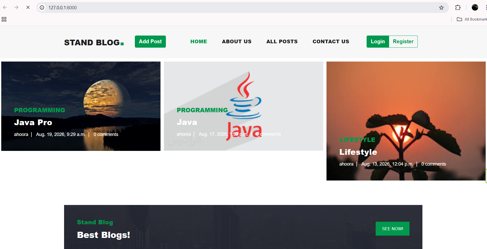
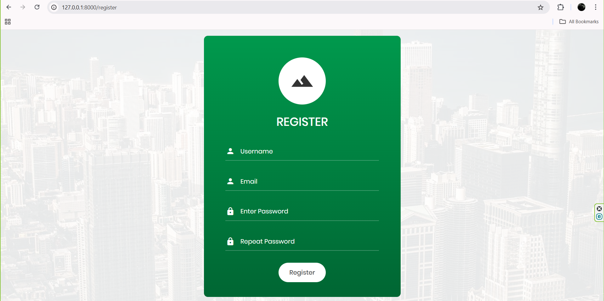
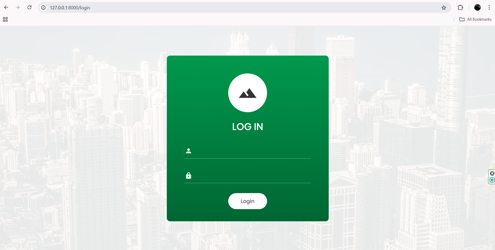
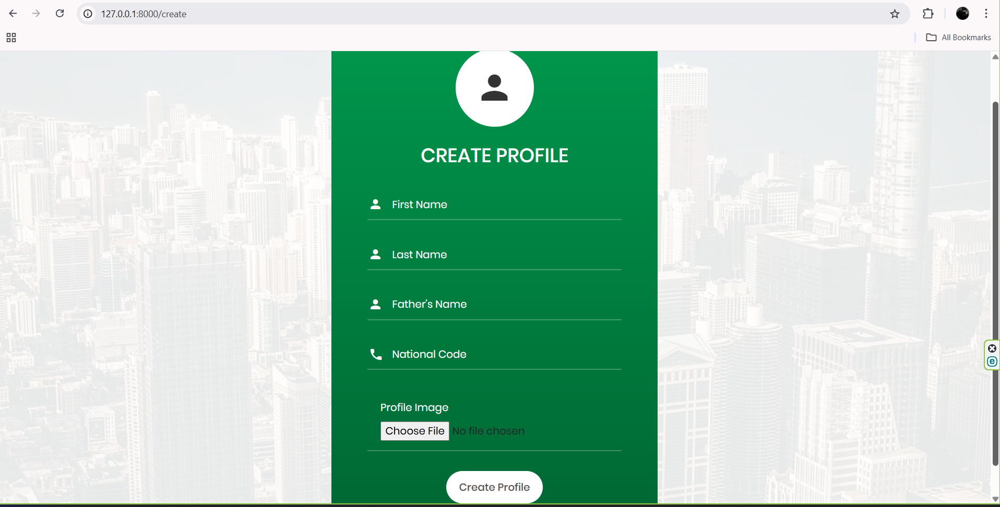
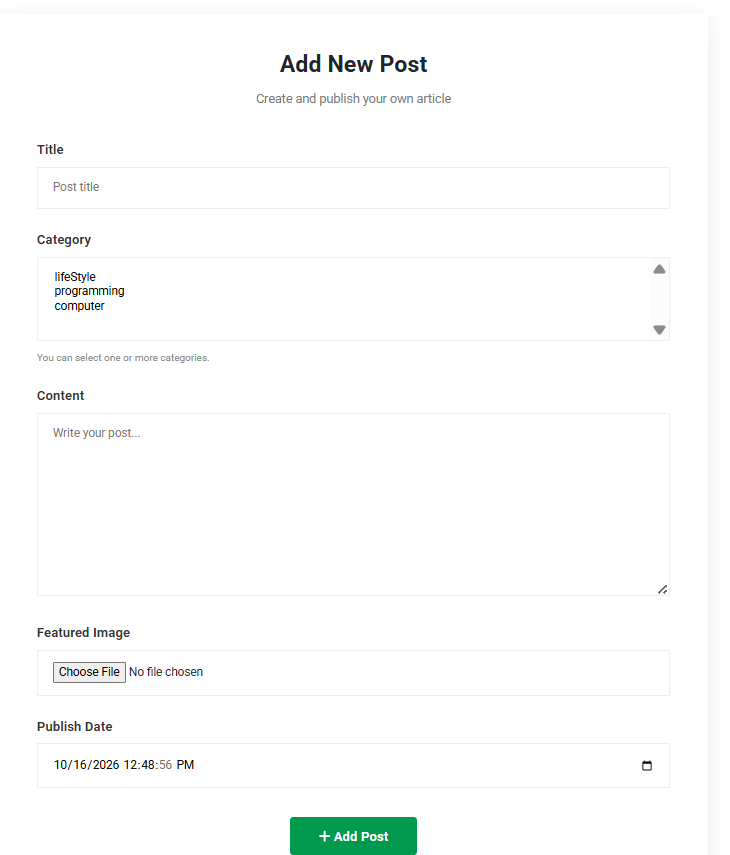
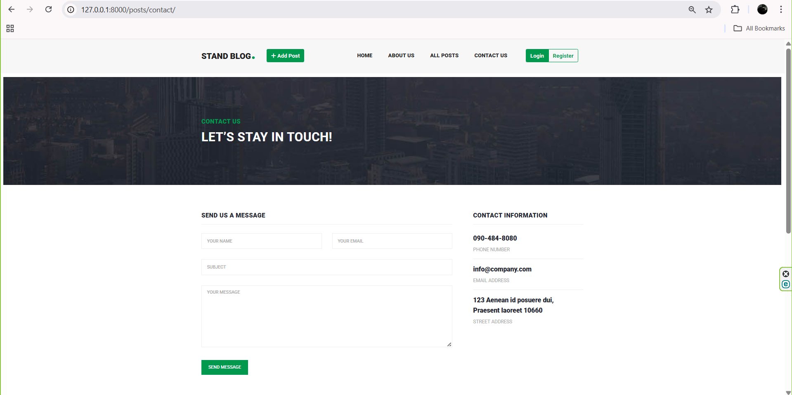
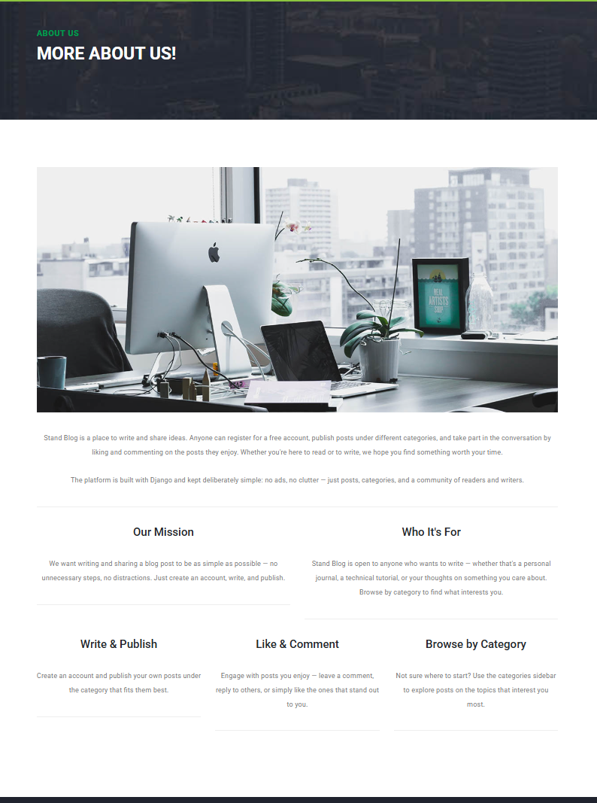

# StandBlog

A blog platform built with Django. Users can register, create profiles, publish posts with images, comment on posts (including threaded replies), like posts, browse by category, and search.

<!-- Optional: add 1-3 screenshots or a short GIF of the homepage / post page here -->

## Features

- User registration, login, and logout
- Editable user profiles with a profile picture
- Create and delete blog posts, each with an image and one or more categories
- Threaded comments (replies to comments)
- Like / unlike posts without a page reload (AJAX)
- Category pages, sorted by number of posts
- Search by post title, with pagination
- Contact form, with a separate inbox view for staff members
- Social share buttons on each post
- Old post images are deleted automatically when a post's image is replaced or the post is removed

## Screenshots

### Home Page

.png)

### User Authentication
**Registration**



**Login**



### User Profile
**Create Profile**



### Blog Posts
**Add Post**



**All Posts**


### Other Pages
**Contact Us**



**About Us**



## Tech stack

- Python, Django 6
- SQLite (default database, easy to swap for Postgres/MySQL later)
- Pillow for image handling
- django-social-share, django-cleanup

## Project structure

```
standblog/
├── standblog/      # project settings, root urls
├── home/           # landing page
├── account/        # auth, profiles
├── blog/           # posts, categories, comments, likes, contact form
├── templates/       # HTML templates
├── static/          # CSS/JS/images shipped with the project
└── media/            # user-uploaded images
```

## Getting started

```bash
git clone https://github.com/Beirami13/standblog.git
cd standblog

python -m venv venv
source venv/bin/activate      # Windows: venv\Scripts\activate

pip install -r requirements.txt

python manage.py migrate
python manage.py createsuperuser
python manage.py runserver
```

The site will be available at `http://127.0.0.1:8000`.

## Note on settings

This repo currently ships with the default `SECRET_KEY` Django generates on `startproject` and `DEBUG = True`. That's fine for running it locally, but before deploying anywhere public, move the secret key and debug flag out of `settings.py` and into environment variables.

## What's next

## What's Next

- [ ] **Improve Security:** Review `settings.py` and configure `SECRET_KEY` to be read from an environment variable. Set `DEBUG = False` in production and configure the required production settings.

- [ ] **Add Automated Tests:** Write tests for user registration, login, post creation, and access permissions to verify that users can only perform actions they're authorized to do.

- [ ] **Document Test Execution:** Add instructions for running the automated tests. For Django's built-in test runner, use:

  ```bash
  python manage.py test
  ```

